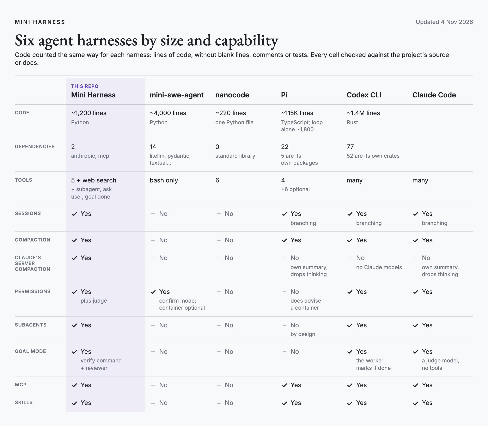
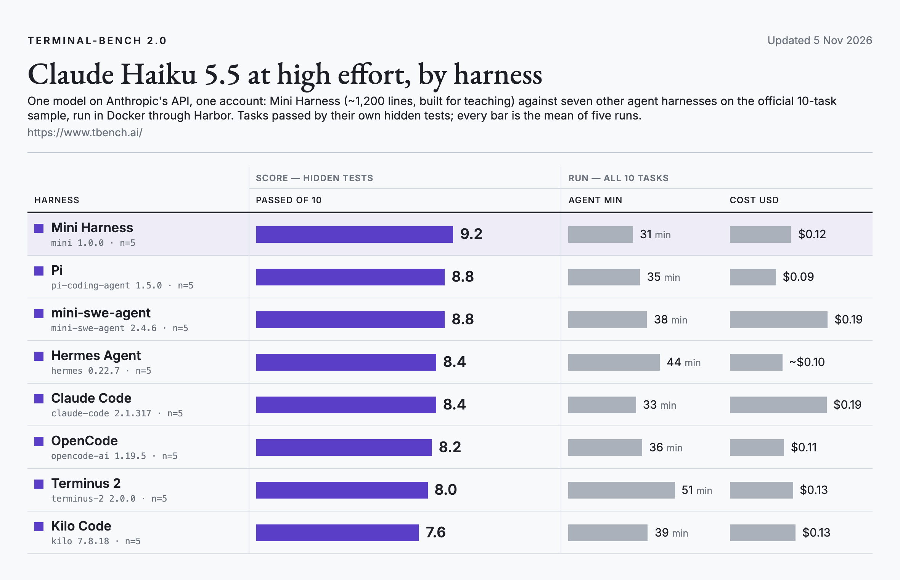
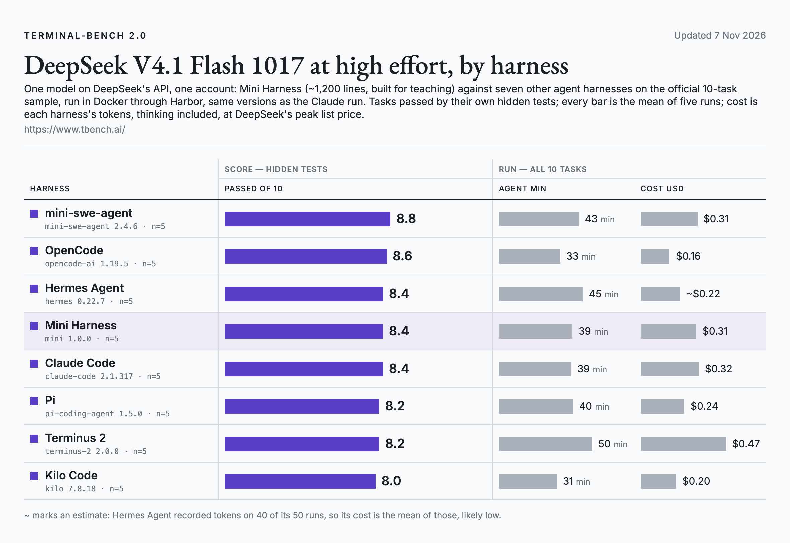
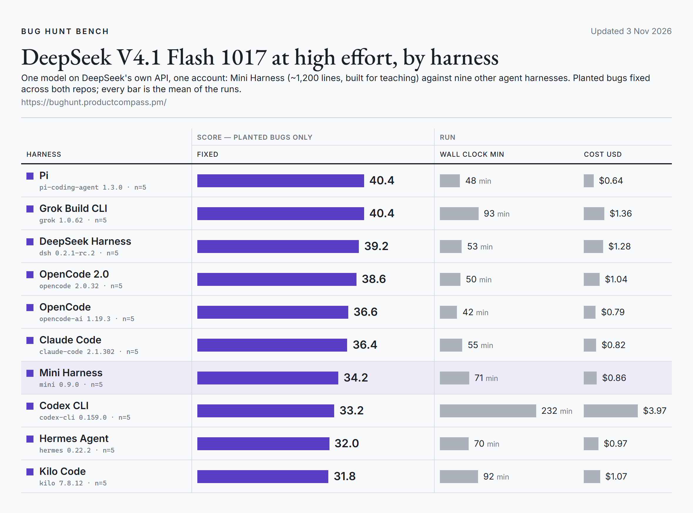

[](https://github.com/phuryn/mini-harness/blob/main/LICENSE.md)
[](https://github.com/phuryn/mini-harness/actions/workflows/tests.yml)

# mini

An agent harness built for teaching: about 1,200 lines of Python and two dependencies, small enough to read in one sitting.

Other minimal harnesses exist, but none has goal mode, permissions, skills and MCP servers. I wanted a fully working one to explain how a harness is built, down to Anthropic's server-side compaction. That's why it runs on Claude and on other models that speak Anthropic's message format.

It has a tool loop, five local tools plus web search, sessions you can resume, compaction, Agent Skills, MCP servers, subagents, a `/goal` mode with an independent reviewer, permission prompts with an optional AI judge, and memory kept in markdown files.

## What's different

- **Built to be read.** One small folder, with no framework and no plugin system. Every part exists because something specific broke without it.
- **The worker never grades itself.** In `/goal` mode, a claimed "done" counts only after the verify command passes and a reviewer with a fresh context checks the work.
- **Permissions with an AI judge.** Risky actions ask you, or go to a small decision model that answers in about 0.3 seconds for a fraction of a cent.
- **Never edits what it already sent.** The conversation is append-only, which keeps Claude's thinking valid and the cache warm across long sessions, resumes and compaction.
- **Uses existing formats.** Skills and MCP servers set up for Claude Code work as they are, and hosted OAuth servers like Linear connect through `mcp-remote`.

## How it compares

<picture>
  <source media="(prefers-color-scheme: dark)" srcset="docs/img/compare-dark.png">
  
</picture>

As of November 2026. Pi is built to be extended; mini is built to be read.

<details>
<summary>The same table as text</summary>

| | **Mini Harness** | mini-swe-agent | nanocode | Pi | Codex CLI | Claude Code |
|---|---|---|---|---|---|---|
| Code | ~1,200 lines (Python) | ~4,000 lines (Python) | ~220 lines (one Python file) | ~115K lines (TypeScript; loop alone ~1,800) | ~1.4M lines (Rust) |  |
| Dependencies | 2 (anthropic, mcp) | 14 (litellm, pydantic, textual...) | 0 (standard library) | 22 (5 are its own packages) | 77 (52 are its own crates) |  |
| Tools | 5 + web search (+ subagent, ask user, goal done) | bash only | 6 | 4 (+6 optional) | many | many |
| Sessions | yes | no | no | yes, branching | yes, branching | yes, branching |
| Compaction | yes | no | no | yes | yes | yes |
| Claude's server compaction | yes | no | no | no, own summary, drops thinking | no, no Claude models | no, own summary, drops thinking |
| Permissions | yes, plus judge | yes, confirm mode; container optional | no | no, docs advise a container | yes | yes |
| Subagents | yes | no | no | no, by design | yes | yes |
| Goal mode | yes, verify command + reviewer | no | no | no | yes, the worker marks it done | yes, a judge model, no tools |
| MCP | yes | no | no | yes | yes | yes |
| Skills | yes | no | no | yes | yes | yes |

</details>

### On Terminal-Bench 2.0

[Terminal-Bench 2.0](https://www.tbench.ai/) gives an agent a job in a Docker container, such as building a Cython extension, setting up a git web server or booting an Alpine VM in QEMU, and checks the result with hidden tests. On its official 10-task sample, run through Harbor with the same model for every harness, five runs each, [mini 1.0.0](https://github.com/phuryn/mini-harness/tree/767a0b4) passed:

- **Claude Haiku 5.5 at high effort:** 9.2 of 10 on average, the highest of eight harnesses, ahead of Pi and mini-swe-agent (8.8), in 31 agent minutes and for $0.11 a run.
- **DeepSeek V4.1 Flash 1017 at high effort**, on DeepSeek's own API: 8.4, level with Claude Code and Hermes Agent, behind mini-swe-agent (8.8) and OpenCode (8.6). Cost is each harness's tokens at DeepSeek's list price.

<picture>
  <source media="(prefers-color-scheme: dark)" srcset="docs/img/terminal-bench-dark.png">
  
</picture>

<picture>
  <source media="(prefers-color-scheme: dark)" srcset="docs/img/terminal-bench-deepseek-dark.png">
  
</picture>

Gaps under about one task are within run-to-run noise: a single harness moved by up to four tasks between runs. Some Claude runs were on a Mac and the rest on x86 Linux, with the same harness versions.

One task was re-run. In build-cython-ext, the hidden test runs `uv run pytest`, and uv prefers any uv-managed Python over the system one. The three harnesses that install through uv (Mini Harness, mini-swe-agent, Hermes Agent) left such a Python behind, so 10 of 11 checks passed and the last one ran in an interpreter without pytest: 0 of 5 for all three, on both models. With their Pythons installed elsewhere (`UV_PYTHON_INSTALL_DIR`), all three passed 5 of 5 on both models. Every other result is from the original runs; the raw results and both summaries are kept.

### On Bug Hunt Bench

[Bug Hunt Bench](https://bughunt.productcompass.pm/) plants 105 bugs in two codebases and counts how many an agent fixes. With one model for every harness, DeepSeek V4.1 Flash 1017 at high effort on DeepSeek's own API, [mini 0.9.0](https://github.com/phuryn/mini-harness/tree/c936132) fixed 34.2 on average over five runs, between Claude Code (36.4) and Codex CLI (33.2), in 71 minutes and for $0.86 a run.

<picture>
  <source media="(prefers-color-scheme: dark)" srcset="docs/img/bug-hunt-bench-dark.png">
  
</picture>

## Install

mini is a Python program, installed with [uv](https://docs.astral.sh/uv/), which also fetches Python 3.12+ if you don't have it.

**macOS / Linux** (Terminal)

```bash
curl -LsSf https://astral.sh/uv/install.sh | sh
# open a new terminal window, so uv is on PATH
uv tool install git+https://github.com/phuryn/mini-harness
```

**Windows** (PowerShell)

```powershell
winget install Git.Git                   # uv needs git to fetch mini; mini's bash tool runs Git Bash
powershell -ExecutionPolicy ByPass -c "irm https://astral.sh/uv/install.ps1 | iex"
# open a new PowerShell window, so git and uv are on PATH
uv tool install git+https://github.com/phuryn/mini-harness
```

Either way, the last command ends with `Installed 1 executable: mini`. Update later with `uv tool upgrade mini`; remove with `uv tool uninstall mini`.

## Keys

mini reads its keys from environment variables. Only the first is required.

| Variable | What it's for | Where to get it |
|---|---|---|
| `ANTHROPIC_API_KEY` | Claude models (required for the default setup) | [console.anthropic.com](https://console.anthropic.com/settings/keys) |
| `OPENROUTER_API_KEY` | The permission judge, Jev. With this key set, Jev approves risky actions it's sure about and asks you only when it isn't | [openrouter.ai/keys](https://openrouter.ai/keys) |
| `DEEPSEEK_API_KEY` | DeepSeek models (`--model deepseek-flash`) | [platform.deepseek.com](https://platform.deepseek.com/api_keys) |

Set them once, so every new terminal has them:

```bash
# macOS (zsh); on Linux use ~/.bashrc
echo 'export ANTHROPIC_API_KEY="sk-ant-..."' >> ~/.zshrc
echo 'export OPENROUTER_API_KEY="sk-or-..."' >> ~/.zshrc
source ~/.zshrc
```

```powershell
# Windows: saved for new windows, so open a new PowerShell afterwards
setx ANTHROPIC_API_KEY "sk-ant-..."
setx OPENROUTER_API_KEY "sk-or-..."
```

A model whose key is missing refuses to start and says which variable to set. Keys never go on the command line or in a config file.

## First run

**Interactive.** Start it in a project and talk to it. `/help` lists commands, `/exit` quits. The first line shows the model and who approves risky actions: `permissions judge` when the OpenRouter key is set, `permissions ask` otherwise.

```bash
cd ~/some/project
mini                                  # or start on another model: mini --model claude-sonnet-5-5
```

**Unattended.** `-p` runs one prompt, prints the answer and exits. Nobody is there to approve risky actions, so they're denied unless `--allow` covers them.

```bash
cd ~/some/project
mini -p "explain this repo in five bullets"
```

The flags work the same in both modes: `--model`, `--effort`, `--permissions` and `--allow` all apply to an interactive session too. `mini --models` lists the models your keys can use. Every flag is under [Using it](#using-it).

The `bash` tool runs bash: from `PATH` on macOS and Linux (falling back to `/bin/sh` without it), Git Bash on Windows. On Windows without Git for Windows it falls back to `cmd.exe`; `MINI_BASH` points it to another `bash.exe`. `MINI_NO_WEB=1` leaves web search out of the tools, for runs that must not look anything up. `MINI_NO_TASK=1` leaves out subagents (the `/goal` reviewer still runs).

To work on mini itself: `git clone https://github.com/phuryn/mini-harness && cd mini-harness && uv sync && uv run pytest -q`, then `uv run --project <clone> mini` from any folder.

## Using it

| Command | What it does |
|---|---|
| `/new [model]` | Start a fresh session, on another model if given |
| `/effort [level]` | Show or change the effort for the next requests |
| `/permissions [mode]` | `ask`, `judge` or `yes`: who approves risky calls |
| `/sessions`, `/resume [id]` | List this directory's sessions, newest first, with last update, prompts and the first prompt as a title (`*` marks the one you're in); resume the latest or one by id prefix |
| `/context` | How full the context is (the size the API reported for the last request) and what fills it: system prompt, mini's tools, MCP tools, web search, conversation |
| `/compact` | Replace the history with a summary now |
| `/dream` | Tidy `memory/`: merge duplicates, drop what's stale |
| `/goal <objective>` | Keep working until the objective is done; also `resume`, `clear`, `status` |
| `/exit` | Quit. Every message is already saved |

Ctrl-C stops the current turn and keeps the session valid.

| Flag | What it does |
|---|---|
| `-p "..."` | Run one prompt headless and print the answer (`--json` for one JSON line with status and cost) |
| `-c` / `-r <id>` | Continue the latest session, or resume one |
| `--model`, `--effort` | Model (default: `main` in `models.json`) and effort (default `high`); `--models` lists what your keys can use |
| `--allow "python3 -m pytest"` | Pre-approve bash commands starting with these words, or MCP tools starting with this prefix (repeatable). Headless mode denies everything else |
| `--permissions ask\|judge\|yes` | Who approves risky calls: you, the Jev judge, or nobody (`yes`: only in a sandbox). Default: `judge` when `OPENROUTER_API_KEY` is set, else `ask`; headless runs default to `ask` |
| `--goal "..." --verify "pytest -q"` | Headless goal mode; done only when the verify command passes and a fresh reviewer agrees |
| `--max-turns N`, `--budget 2.50` | Limits for goal mode |

**Project files it reads.** `AGENTS.md` (instructions), `memory/INDEX.md` (memory, which the model keeps up to date), skills in `skills/`, `.claude/skills/` or `.agents/skills/` (plus `~/.mini/skills/`), and MCP servers in `mcp.json` or `.mcp.json` (plus `~/.mini/mcp.json`). Skills and MCP use the same formats as Claude Code, so existing ones work as they are. Only each skill's name and description go into the prompt; the model reads the full `SKILL.md` when a task matches.

**MCP.** Servers run over stdio, as any command:

```json
{"mcpServers": {
  "github": {"command": "npx", "args": ["-y", "@modelcontextprotocol/server-github"]},
  "linear": {"command": "npx", "args": ["-y", "mcp-remote", "https://mcp.linear.app/mcp"]}
}}
```

Hosted servers with OAuth go through `mcp-remote`, which runs the login in your browser once and keeps the token. Tested with Linear. Every MCP call asks first unless `--allow` covers it (e.g. `--allow mcp__linear__list_` for Linear's read-only list tools).

## Models and prices

Every model setting lives in one file, [`src/mini/models.json`](src/mini/models.json): which model is the default, which ones subagents use, and each model's prices, context window and compaction threshold. No model name is written in the code. To change or add something without touching the repo, put the same shape in `~/.mini/models.json`; its entries override or extend the shipped ones.

```json
{
  "main": "claude-opus-5-5",
  "subagent": "claude-sonnet-5-5",
  "subagent_cheap": "claude-haiku-5-5",
  "models": {
    "claude-*": {"window": 1000000, "compact_at": 150000, "search": 0.01, "fallbacks": true,
                 "efforts": ["low", "medium", "high", "xhigh", "max"],
                 "prices": {"input": 4, "output": 20, "cache_read": 0.20, "cache_write": 5}},
    "claude-sonnet-5-5": {"prices": {"input": 2, "output": 10, "cache_read": 0.20, "cache_write": 2.5}},
    "my-model": {"base_url": "https://example.com/anthropic", "key": "MY_API_KEY",
                 "window": 262144, "compact_at": 150000, "search": 0, "efforts": ["low", "high"],
                 "prices": {"input": 0.5, "output": 2, "cache_read": 0.05, "cache_write": 0.5}}
  }
}
```

| Field | Meaning |
|---|---|
| `main`, `subagent`, `subagent_cheap` | Default model; the model for subagents and the goal reviewer; the cheaper one the main model may pick for plain reading or search |
| `prices` | Dollars per million tokens: `input`, `output`, `cache_read` (repeated context, about a tenth of input) and `cache_write` (first time context is cached). mini multiplies each request's token counts by these and adds them up, for `--json` and the `--budget` limit. It isn't shown while you work |
| `prices_over_100k` | Optional higher rates for prompts over 100K tokens (Haiku 5.5 has them) |
| `window` | Context window in tokens (shown by `/context`) |
| `compact_at` | Input tokens at which the conversation is summarized; keep it well below `window`. `MINI_COMPACT_AT` overrides it |
| `search` | Dollars per web search |
| `efforts` | Effort levels the model accepts |
| `fallbacks` | Claude only: if the model declines partway, the API continues on another model |
| `base_url`, `key` | Only for non-Claude models: the provider's Anthropic-format endpoint, and the name of the environment variable that holds its key (never the key itself) |

**A new Claude model** needs one entry with its `prices`; everything else comes from `"claude-*"`. An unlisted Claude model still runs (`--model claude-<name>`) at the default prices. When names change, edit `main`, `subagent` and `subagent_cheap`.

**Any other model** must serve Anthropic's Messages format (DeepSeek, Kimi, GLM and others offer such an endpoint) and needs every field, including `base_url` and `key`. It runs the same loop, tools and sessions, with three differences: no thinking-block binding, betas or fallbacks are sent; mini summarizes the conversation itself instead of the server; and subagents run on the same model. DeepSeek V4.1 Flash ships as `deepseek-flash`. OpenAI-format endpoints aren't supported; they'd need a translation layer for messages, tools and thinking.

## How it works

- **The loop.** Send the conversation, stream the reply, run the tools the model asked for, send the results back, repeat until it stops asking. The rest is bookkeeping around that loop.
- **Append-only transcript.** The system prompt and tool list are frozen at session start; nothing already sent is ever edited. Current Claude models bind thinking blocks to everything before them, so an edit would break the conversation. Later instructions are appended as system messages.
- **Sessions.** One JSONL file per conversation under `~/.mini/sessions/<project>/`. Resuming means reading it back; a crash mid-tool is repaired on resume, by appending.
- **Every tool call gets an answer**, including failures, denials and interrupts, so the transcript stays valid.
- **Tools.** `read` (text, or a PNG, JPEG, GIF or WebP image the model sees, up to 3000 px a side and 20 MB of images per conversation), `write`, `edit`, `bash` (with `background` for servers and long builds: detached, output in a log under `~/.mini/jobs/`), `find`, plus `web_search` (direct searches only, without Anthropic's code sandbox), `task` (a subagent with a fresh context that returns only its answer), `ask_user` (a question, optionally with numbered options; left out of headless runs) and `goal_done`. Errors tell the model what to do next. If a reply hits the output limit, mini tells the model and lets it continue, twice per turn; a goal pauses after that.
- **Permissions.** Reads, searches and edits inside the project run freely. Reading outside the project, or any file that may hold secrets (`.env`, keys, `~/.ssh`, `~/.aws`, credentials files), needs approval, because whatever the model reads goes to the API and into the session file. In judge mode Jev can approve reads outside the project, but secrets and writes to files that run later always ask you. Searches never look inside those files, and `cat`/`head` lose their free pass on such paths. Read-only git (`status`, `diff`, `log`, `show`) runs without asking. Other bash commands, MCP calls, writes outside the project and writes to files that run later (`.git/`, `Makefile`, `package.json`...) ask first, or go to [Jev](https://www.productcompass.pm/p/jev-decision-model), a small decision model, in `judge` mode. Background job logs read freely. The system prompt tells the model who approves in this session, and a note tells it when `/permissions` changes that. This is a gate, not a sandbox.
- **`/goal`.** The model keeps working until it calls `goal_done`. The harness then runs `--verify`, and a reviewer subagent with an empty context checks the work. The worker never grades itself.
- **Cost.** Every request is priced from its token usage with the rates in `models.json` and summed. It isn't shown while you work: `--json` reports it, and `--budget` uses it to stop a long goal run.

## Left out on purpose

A full-screen UI, hooks, plugins, a sandbox, checkpoints (use git), forked or parallel subagents, OpenAI-format providers, switching models mid-session, and editor integration.

## Tests

```bash
uv run pytest -q
```

156 offline tests against a scripted fake client and a real MCP stdio server. They check the invariants above: append-only requests, an answer for every tool call, resume, compaction, interrupts, goal mode, subagent isolation. `AGENTS.md` has the rules for changing the code.
