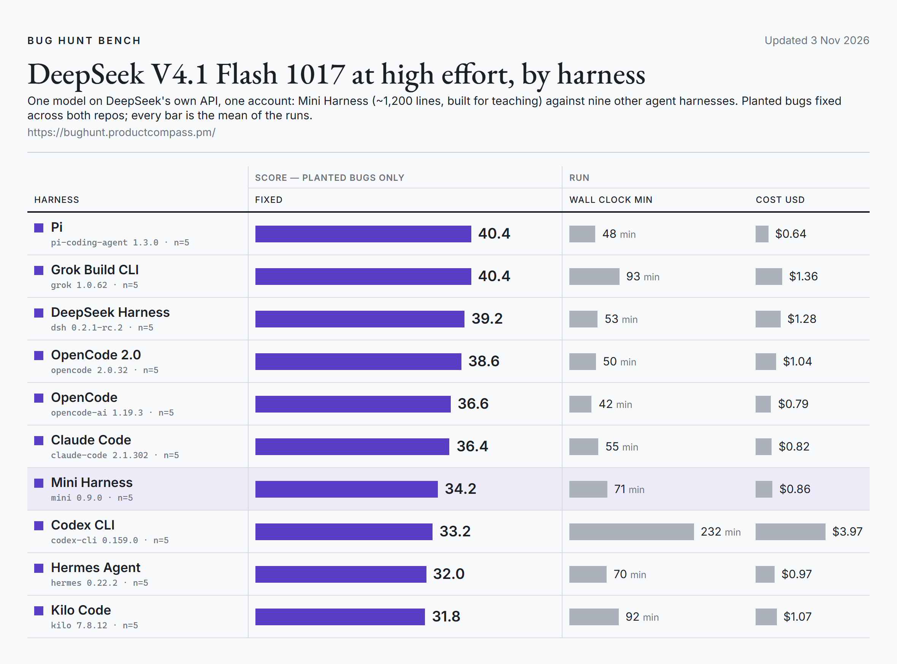

# Bug Hunt Bench · DeepSeek V4.1 Flash 1017

[Bug Hunt Bench](https://bughunt.productcompass.pm/) plants 105 bugs in two codebases (45 and 60) and counts how many an
agent fixes; a blind judge grades each fix from the agent's diff, not from its report. Five runs per harness, DeepSeek
V4.1 Flash 1017 at high effort on DeepSeek's own API, one account.

<picture>
  <source media="(prefers-color-scheme: dark)" srcset="../../docs/img/bug-hunt-bench-dark.png">
  
</picture>

| Harness | Version | Run 1 | Run 2 | Run 3 | Run 4 | Run 5 | Mean fixed, of 105 | Wall min per run | Cost per run |
|---|---|---|---|---|---|---|---|---|---|
| Pi | 1.3.0 | 40 | 39 | 41 | 38 | 44 | **40.4** | 48 | $0.64 |
| Grok Build CLI | 1.0.62 | 44 | 40 | 44 | 34 | 40 | **40.4** | 93 | $1.36 |
| DeepSeek Harness | 0.2.1-rc.2 | 45 | 37 | 41 | 41 | 32 | **39.2** | 53 | $1.28 |
| OpenCode | 2.0.32 | 37 | 38 | 43 | 40 | 35 | **38.6** | 50 | $1.04 |
| OpenCode | 1.19.3 | 35 | 37 | 43 | 28 | 40 | **36.6** | 42 | $0.79 |
| Claude Code | 2.1.302 | 34 | 30 | 42 | 38 | 38 | **36.4** | 55 | $0.82 |
| Mini Harness | 0.9.0 | 28 | 33 | 42 | 29 | 39 | **34.2** | 71 | $0.86 |
| Codex CLI | 0.159.0 | 34 | 32 | 30 | 35 | 35 | **33.2** | 232 | $3.97 |
| Hermes Agent | 0.22.2 | 24 | 38 | 32 | 30 | 36 | **32.0** | 70 | $0.97 |
| Kilo Code | 7.8.12 | 35 | 35 | 33 | 24 | 32 | **31.8** | 92 | $1.07 |

## Setup

- Runs: October–November 2026, each harness on a fresh copy of both codebases, high effort.
- Cost: at DeepSeek's list price.
- The benchmark, its prompts and per-run receipts for its own leaderboard (which includes Claude Code, DeepSeek Harness,
  OpenCode 1.19.3 and Pi from this table) are in [phuryn/bug-hunt-bench](https://github.com/phuryn/bug-hunt-bench).

## Files

- `trials.csv`: one row per run. `fixed` is planted bugs fixed of 105, `fixed_repo1` of the 45 in the first codebase,
  `fixed_repo2` of the 60 in the second; `wall_minutes` is the agent's time on both; `cost_usd` is that run's cost.
- `summary.csv`: one row per harness, the numbers in the table above.
