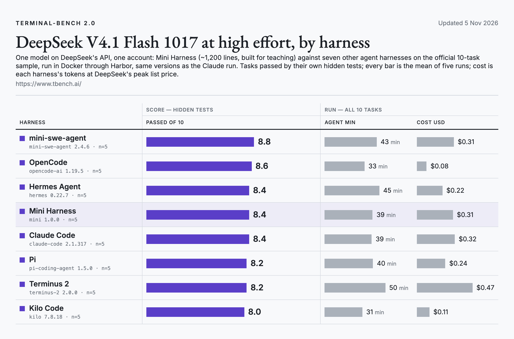

# Terminal-Bench 2.0 sample · DeepSeek V4.1 Flash 1017

The official 10-task sample of [Terminal-Bench 2.0](https://www.tbench.ai/) (`terminal-bench-sample@2.0`), five runs per harness, DeepSeek V4.1 Flash 1017 at high effort on DeepSeek's own API, one account.

<picture>
  <source media="(prefers-color-scheme: dark)" srcset="../../docs/img/terminal-bench-deepseek-dark.png">
  
</picture>

| Harness | Version | Run 1 | Run 2 | Run 3 | Run 4 | Run 5 | Mean, of 10 | Agent min per run | Cost per run |
|---|---|---|---|---|---|---|---|---|---|
| mini-swe-agent | 2.4.6 | 9 | 9 | 7 | 9 | 10 | **8.8** | 43 | $0.31 |
| OpenCode | 1.19.5 | 9 | 8 | 9 | 9 | 8 | **8.6** | 33 | $0.08 |
| Hermes Agent | 0.22.7 | 9 | 9 | 8 | 7 | 9 | **8.4** | 45 | $0.22 |
| Mini Harness | 1.0.0 | 9 | 8 | 7 | 9 | 9 | **8.4** | 39 | $0.31 |
| Claude Code | 2.1.317 | 9 | 8 | 8 | 8 | 9 | **8.4** | 39 | $0.32 |
| Pi | 1.5.0 | 7 | 8 | 9 | 8 | 9 | **8.2** | 40 | $0.24 |
| Terminus 2 | 2.0.0 | 9 | 9 | 7 | 8 | 8 | **8.2** | 50 | $0.47 |
| Kilo Code | 7.8.18 | 8 | 9 | 7 | 10 | 6 | **8.0** | 31 | $0.11 |

## Setup

- Runner: [Harbor](https://github.com/laude-institute/harbor) 0.25.0, Docker, each task's own time limit and resources.
- When: 4–5 Nov 2026.
- Cost: every harness's tokens at DeepSeek's peak list price ($0.30 per million input tokens, $0.006 cached, $1.20 output; off-peak hours cost half); Mini Harness reports its own cost from the same prices.
- Harnesses: mini-swe-agent 2.4.6, OpenCode 1.19.5, Hermes Agent 0.22.7, Mini Harness 1.0.0, Claude Code 2.1.317, Pi 1.5.0, Terminus 2 2.0.0, Kilo Code 7.8.18.

## Files

- `trials.csv`: one row per run of a task, for every harness. `passed` is 1 when the task's hidden tests passed;
  `agent_seconds` is the agent's own time (container setup excluded); `cost_usd` is the run's tokens at DeepSeek's peak list price; Mini Harness reports its own cost from the same prices. `cost_usd` is blank
  when a run recorded no cost or token counts (Hermes Agent 10, Mini Harness 1 runs). `error` names how a run ended when it did not end on its
  own (`AgentTimeoutError` = stopped at the task's time limit).
- `summary.csv`: one row per harness, the numbers in the table above. Cost per run is the mean cost of the runs
  that recorded one, times the number of tasks.
