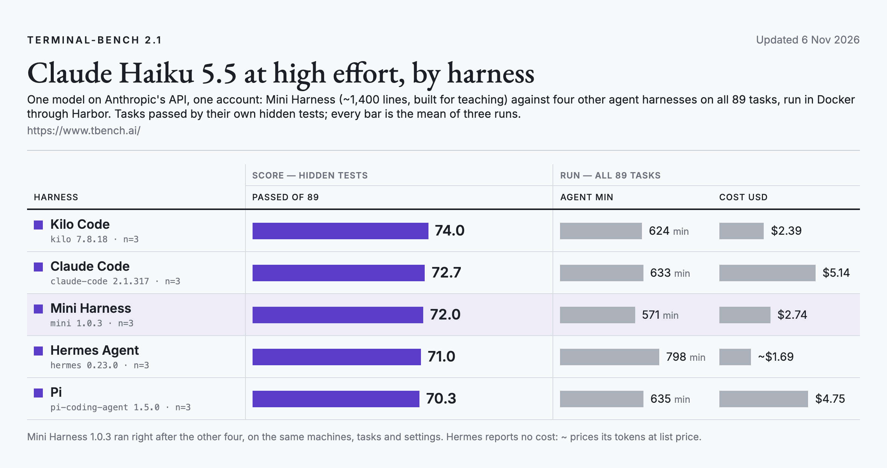

# Terminal-Bench 2.1 · Claude Haiku 5.5

All 89 tasks of [Terminal-Bench 2.1](https://www.tbench.ai/), three runs per harness, Claude Haiku 5.5 at high effort on Anthropic's API, one account.

<picture>
  <source media="(prefers-color-scheme: dark)" srcset="../../docs/img/terminal-bench-2.1-dark.png">
  
</picture>

| Harness | Version | Run 1 | Run 2 | Run 3 | Mean, of 89 | Agent min per run | Cost per run |
|---|---|---|---|---|---|---|---|
| Kilo Code | 7.8.18 | 72 | 78 | 72 | **74.0** | 624 | $2.39 |
| Claude Code | 2.1.317 | 74 | 72 | 72 | **72.7** | 633 | $5.15 |
| Mini Harness | 1.0.3 | 71 | 71 | 74 | **72.0** | 571 | $2.74 |
| Hermes Agent | 0.23.0 (0.22.7 on 13 of 267 task runs) | 68 | 72 | 73 | **71.0** | 798 | ~$1.69 |
| Pi | 1.5.0 | 70 | 72 | 69 | **70.3** | 636 | $4.75 |

## Setup

- Runner: [Harbor](https://github.com/laude-institute/harbor) 0.25.0, dataset `terminal-bench/terminal-bench-2-1`, Docker, each task's own time limit and resources.
- Machines: nine DigitalOcean droplets (8 vCPU, 16 GB), six runs at a time on each; every harness ran a given task on the same machine.
- When: Kilo Code, Claude Code, Hermes Agent and Pi ran together on 5–6 Nov 2026; Mini Harness 1.0.3 ran right after, on 6 Nov, on the same machines, tasks and settings.
- Effort: `--effort high`; Hermes Agent takes it from its config file.
- Cost: what each harness reports. Hermes Agent reports none, so its runs are priced from its tokens at Haiku 5.5's list price (marked ~; an estimate that may be low).
- Harnesses: Kilo Code 7.8.18, Claude Code 2.1.317, Mini Harness 1.0.3, Hermes Agent 0.23.0 (0.22.7 on 13 of 267 task runs), Pi 1.5.0.

## Files

- `trials.csv`: one row per run of a task, for every harness. `passed` is 1 when the task's hidden tests passed;
  `agent_seconds` is the agent's own time (container setup excluded); `cost_usd` is what the harness reported; for Hermes Agent, which reports none, its tokens at Haiku 5.5's list price (`cost_estimated` = 1, an estimate that may be low). `cost_usd` is blank
  when a run recorded no cost or token counts (Hermes Agent 64, Mini Harness 16, Pi 3 runs). `error` names how a run ended when it did not end on its
  own (`AgentTimeoutError` = stopped at the task's time limit).
- `summary.csv`: one row per harness, the numbers in the table above. Cost per run is the mean cost of the runs
  that recorded one, times the number of tasks.
