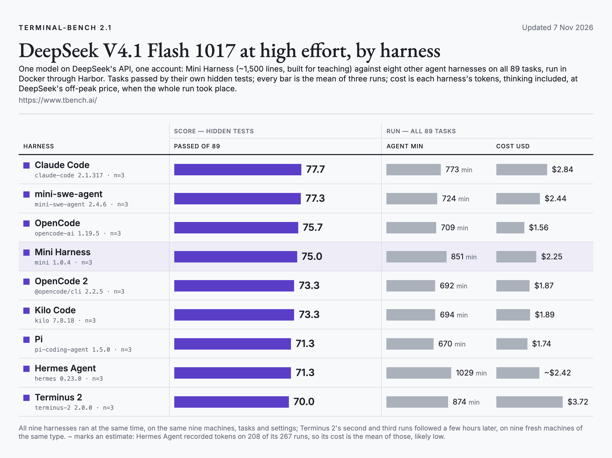

# Terminal-Bench 2.1 · DeepSeek V4.1 Flash 1017

All 89 tasks of [Terminal-Bench 2.1](https://www.tbench.ai/), three runs per harness, DeepSeek V4.1 Flash 1017 at high effort on DeepSeek's own API, one account.

<picture>
  <source media="(prefers-color-scheme: dark)" srcset="../../docs/img/terminal-bench-2.1-deepseek-dark.png">
  
</picture>

| Harness | Version | Run 1 | Run 2 | Run 3 | Mean, of 89 | Agent min per run | Cost per run |
|---|---|---|---|---|---|---|---|
| Claude Code | 2.1.317 | 78 | 79 | 76 | **77.7** | 773 | $2.84 |
| mini-swe-agent | 2.4.6 | 77 | 77 | 78 | **77.3** | 724 | $2.44 |
| OpenCode | 1.19.5 | 78 | 75 | 74 | **75.7** | 709 | $1.56 |
| Mini Harness | 1.0.4 | 73 | 76 | 76 | **75.0** | 851 | $2.25 |
| OpenCode 2 | 2.2.5 | 74 | 70 | 76 | **73.3** | 692 | $1.87 |
| Kilo Code | 7.8.18 | 71 | 73 | 76 | **73.3** | 694 | $1.89 |
| Pi | 1.5.0 | 72 | 72 | 70 | **71.3** | 670 | $1.74 |
| Hermes Agent | 0.23.0 | 76 | 67 | 71 | **71.3** | 1029 | ~$2.42 |
| Terminus 2 | 2.0.0 | 71 | 68 | 71 | **70.0** | 874 | $3.72 |

## Setup

- Runner: [Harbor](https://github.com/laude-institute/harbor) 0.25.0, dataset `terminal-bench/terminal-bench-2-1`, Docker, each task's own time limit and resources.
- Machines: nine DigitalOcean droplets (8 vCPU, 16 GB), six runs at a time on each. All nine harnesses ran side by side, and every harness ran the same task list on each machine. Terminus 2's second and third runs followed on 7 Nov, alone on nine fresh machines of the same type. A first try at them was dropped whole: DeepSeek's API returned server errors for 33 minutes and ended 88 of its 178 runs, while no other harness's runs met a single one.
- When: 6–7 Nov 2026, all of it in DeepSeek's off-peak hours.
- Effort: `--effort high`; OpenCode as `variant=high`; OpenCode 2 as the model's `#high` variant (through a small adapter on Harbor's OpenCode one); Hermes Agent from its config file. Claude Code runs on DeepSeek's Anthropic-compatible endpoint, with every model slot set to the same model.
- Cost: every harness's tokens at DeepSeek's off-peak price ($0.15 per million input tokens, $0.003 cached, $0.60 output), thinking included (OpenCode, OpenCode 2 and Kilo Code log it apart from their output tokens, so it is added back); Mini Harness reports its own cost at the same prices. DeepSeek billed about $65.25 for the run; the priced runs add up to $60.47, and 65 runs recorded no tokens (Hermes Agent 59, marked ~; OpenCode 2 3; Pi 3).
- Harnesses: Claude Code 2.1.317, mini-swe-agent 2.4.6, OpenCode 1.19.5, Mini Harness 1.0.4, OpenCode 2 2.2.5, Kilo Code 7.8.18, Pi 1.5.0, Hermes Agent 0.23.0, Terminus 2 2.0.0.

## Files

- `trials.csv`: one row per run of a task, for every harness. `passed` is 1 when the task's hidden tests passed;
  `agent_seconds` is the agent's own time (container setup excluded); `cost_usd` is the run's tokens (thinking included) at DeepSeek's off-peak price; Mini Harness reports its own cost from the same prices. `cost_usd` is blank
  when a run recorded no cost or token counts (Hermes Agent 59, OpenCode 2 3, Pi 3 runs). `error` names how a run ended when it did not end on its
  own (`AgentTimeoutError` = stopped at the task's time limit).
- `summary.csv`: one row per harness, the numbers in the table above. Cost per run is the mean cost of the runs
  that recorded one, times the number of tasks.
